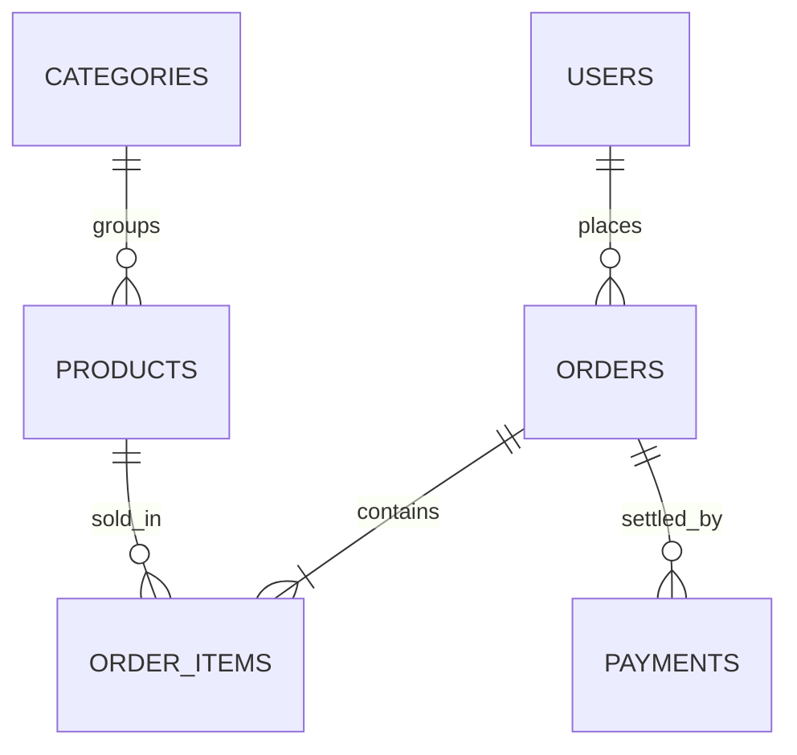

# MDD: Tienda en línea con catálogo, carrito y pagos

## 1. Contexto

La tienda en línea permite a los clientes registrados explorar el catálogo de productos, armar un carrito de compras, confirmar pedidos y pagarlos en línea. El negocio vende ropa y accesorios a nivel nacional y necesita reducir la carga operativa del equipo de ventas, centralizar los pedidos y dejar trazabilidad completa de los pagos. El alcance de esta primera versión incluye el registro y acceso de usuarios, el catálogo con categorías, el flujo de compra, la conciliación básica de pagos y la gestión de pedidos por parte del personal administrativo. Quedan fuera de alcance la facturación electrónica y los vendedores externos.

## 2. Arquitectura y Stack

La solución se compone de una API REST desarrollada en NestJS con TypeScript, una base de datos PostgreSQL para la información transaccional y Redis para la caché del catálogo y las sesiones del carrito. El frontend es una aplicación web que consume la API mediante HTTPS. Los pagos se procesan con un proveedor externo de tarjetas y sus eventos llegan por webhook a un endpoint dedicado. Las tareas asíncronas, como el envío de correos de confirmación, se ejecutan en una cola respaldada por Redis.

## 3. Modelo de Datos

El modelo separa usuarios, catálogo, pedidos y pagos. Cada línea de pedido conserva el precio vigente al momento de la compra para que los cambios posteriores en un producto no alteren el historial.

```sql
CREATE TABLE users (
  id UUID PRIMARY KEY,
  email VARCHAR(255) UNIQUE NOT NULL,
  password_hash VARCHAR(255) NOT NULL,
  role VARCHAR(20) NOT NULL DEFAULT 'customer',
  created_at TIMESTAMPTZ NOT NULL DEFAULT now()
);

CREATE TABLE categories (
  id UUID PRIMARY KEY,
  name VARCHAR(120) NOT NULL UNIQUE
);

CREATE TABLE products (
  id UUID PRIMARY KEY,
  category_id UUID NOT NULL REFERENCES categories(id),
  sku VARCHAR(64) UNIQUE NOT NULL,
  name VARCHAR(255) NOT NULL,
  price_cents INTEGER NOT NULL CHECK (price_cents >= 0),
  stock INTEGER NOT NULL DEFAULT 0 CHECK (stock >= 0)
);

CREATE TABLE orders (
  id UUID PRIMARY KEY,
  user_id UUID NOT NULL REFERENCES users(id),
  status VARCHAR(20) NOT NULL,
  total_cents INTEGER NOT NULL,
  created_at TIMESTAMPTZ NOT NULL DEFAULT now()
);

CREATE TABLE order_items (
  id UUID PRIMARY KEY,
  order_id UUID NOT NULL REFERENCES orders(id),
  product_id UUID NOT NULL REFERENCES products(id),
  quantity INTEGER NOT NULL CHECK (quantity > 0),
  unit_price_cents INTEGER NOT NULL
);

CREATE TABLE payments (
  id UUID PRIMARY KEY,
  order_id UUID NOT NULL REFERENCES orders(id),
  provider_ref VARCHAR(128) UNIQUE NOT NULL,
  amount_cents INTEGER NOT NULL,
  status VARCHAR(20) NOT NULL
);
```



## 4. Contratos de API

Las rutas se agrupan por capacidad. Todas las respuestas usan JSON y los errores siguen el formato estándar del proyecto.

| Método | Ruta | Descripción |
|---|---|---|
| POST | /auth/register | Registro de cliente |
| POST | /auth/login | Inicio de sesión, devuelve un JWT |
| GET | /products | Listado paginado del catálogo |
| GET | /products/:id | Detalle de un producto |
| POST | /cart/items | Agrega un producto al carrito |
| POST | /orders | Crea un pedido desde el carrito |
| GET | /orders/:id | Consulta el estado de un pedido |
| POST | /payments/checkout | Inicia el cobro de un pedido |
| POST | /webhooks/payments | Recibe eventos del proveedor de pagos |

### GET /orders/:id

Devuelve el pedido del usuario autenticado. Responde 404 si el pedido no pertenece al usuario.

```json
{ "id": "3f2c1e10", "status": "PAID", "total_cents": 129900 }
```

## 5. Lógica y Edge Cases

Para evitar sobreventa, el descuento de stock se hace dentro de la misma transacción que la creación del pedido, con bloqueo de fila sobre products. Si el stock cambia entre la adición al carrito y la confirmación, el pedido se rechaza con un mensaje claro y el carrito conserva las demás líneas. Cuando el proveedor de pagos reintenta un webhook, la operación es idempotente gracias a provider_ref único en payments. Si un cobro falla, el pedido queda en estado pendiente de pago durante 30 minutos y después se cancela y libera el stock. Los cambios de precio no afectan a pedidos ya creados porque cada línea guarda su precio unitario.

## 6. Seguridad

Las contraseñas se almacenan con argon2 y nunca en texto plano. La autenticación usa JWT firmados de corta duración con refresh token rotatorio. El control de acceso es RBAC con dos roles, customer y admin; todas las rutas administrativas validan el rol en el servidor. El tráfico viaja solo por TLS 1.2 o superior y el endpoint de login aplica rate limit por IP. Los webhooks de pago se validan con firma HMAC antes de procesarse. Los datos de tarjeta no se almacenan en nuestros sistemas, lo que mantiene el alcance de cumplimiento en el nivel mínimo del proveedor.

## 7. Infraestructura

Los servicios se empaquetan en contenedores Docker: api, worker, postgres y redis, orquestados con docker compose en un servidor virtual privado. PostgreSQL corre con volumen persistente y realiza un backup diario con pg_dump, retenido 14 días en almacenamiento externo; cada mes se prueba una restauración completa. Redis se usa solo como caché y cola, por lo que su pérdida no compromete pedidos ni pagos. Los logs se envían a un colector centralizado y las métricas de latencia y errores se revisan en un panel compartido. El despliegue se hace con una imagen versionada y una migración de base de datos por cada release.
