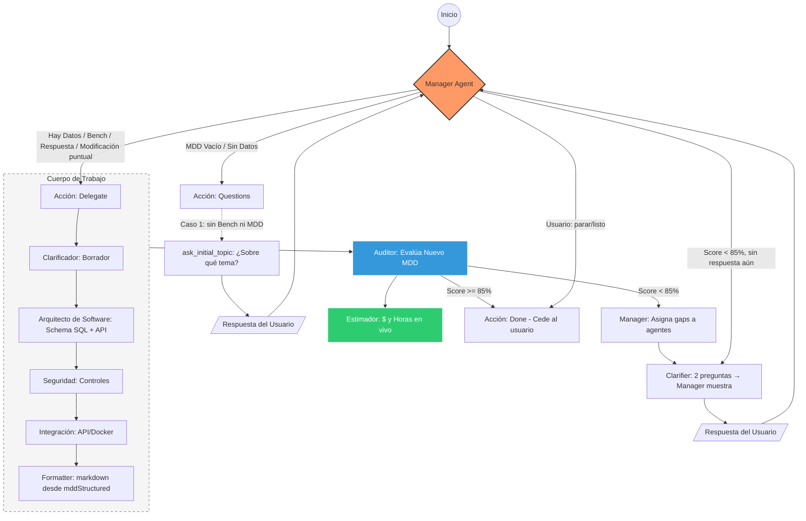

# AiAnalysisModule

Módulo de análisis agentic para **Domain Benchmark & Gap Analysis (DBGA)**. Orquesta agentes especializados (LangGraph) para investigar, scrapear y sintetizar datos de mercado a partir de una idea de usuario.

## Estructura

- **state/** – Estado compartido LangGraph (tipado estricto)
  - `dbga-state.schema.ts` – Schemas Zod y tipos: `CompetitorData`, `DBGAStatus`, `DBGAState`
  - `langgraph-state.annotation.ts` – Anotación LangGraph `DBGAStateAnnotation` para `StateGraph`
  - `index.ts` – Re-export
- **llm/** – `create-dbga-llm.ts` – Runtime BYOK/tenant del usuario (`resolveRuntime`). Perfil de salida: **langgraph 16K** (nodos MDD/DBGA), **auditor 8K** (`createMddAuditorLLM`). `createMddAuditorLLM` usa `resolveAuditorRuntime` (instancia activa, con `auditorChatModel` opcional) para **Auditor** y **Cross-Consistency**; architect/security/integration usan `resolveRuntime` con temperatura 0.2.
- **graph/** – `dbga-graph.ts` – StateGraph compilado; edges Scout → Auditor → Critic → (Scout | Synthesis) → END
- **nodes/** – Nodos por agente: Scout (con tools), Auditor (con tools), Critic, Synthesis
- **tools/** – ToolRegistry e integración externa
  - `tool-registry.ts` – `getScoutTools()` (Tavily + scrape_url), `getAuditorTools()` (scrape_url), `getAgenticRagToolset()` (patch secciones + `propose_mdd_amendment`; TheForge legacy opcional)
  - `agent-sdd-tools.ts` – `patch_mdd_section` (secciones 1–7), `propose_mdd_amendment` (§3/§4)
  - `agent-theforge-tools.ts` – `ask_codebase`, `get_modification_plan`, `validate_before_edit`, `get_file_content`, `get_legacy_impact`, … (fijadas a `theforgeProjectId`); subconjunto **Arquitecto MDD** (`getMddArchitectTheForgeTools`): `get_contract_specs`, `get_implementation_details`, `get_legacy_impact`
  - `tavily.tool.ts` – Búsqueda web para Scout (`TAVILY_API_KEY`)
  - `scrape-cheerio.tool.ts` – Scrape URL → markdown + metadata (Cheerio + fetch; sin API key)
- **prompts/** – Prompts por dominio: `benchmark/` (scout, auditor, critic, synthesis), `mdd/` (clarifier, security-architect, integration-engineer, auditor; **esqueleto constitución YAGNI:** `prompts/mdd/mdd-constitution-skeleton.md` + `prompts/mdd/README.md`); `load-prompts.ts` carga desde subcarpetas (`MDD_CONSTITUTION_SKELETON_MARKDOWN`)
- **utils/mdd-architect-pipeline.util.ts** – Pipeline HIGH: §2 (`stack_architect`) → §3 (`data_model`) → critic → §4 (`api_contracts`); §5 siempre vía `tail_parallel`/`section5`. LOW/MEDIUM: `software_architect` monolítico.
- **ai-analysis.service.ts** – Orquestación; `startAnalysis(idea)` invoca el grafo; `streamAnalysis(idea, projectId)` emite progreso + markdown final y, si hay `projectId`, **inferencia LLM de `complexity`** (`DiscoveryService.inferComplexity`) + `PATCH` del proyecto antes del evento `done`.
- **estimation/** – Estimación en vivo independiente del flujo de agentes
  - `estimation.types.ts` – `MDDReference`, `MDDContext`, `LiveMetricsResult` (`roles` / `rolesHours` dinámicos, `readinessHints` para UI Workshop), `PrecisionBreakdown` (con `sectionStatus` opcional para "Estado Inconsistente"), tarifas y umbrales (Rojo &lt;85%, Amarillo 85–89%, Verde ≥90% con trazabilidad BRD→MDD ≥90% y ≤5 brechas transversales)
  - `estimation.service.ts` – métricas en vivo; **trazabilidad BRD→MDD** (`consistency.util.ts` + `brd-mdd-traceability.util.ts` compartido con auditor y delivery gate); hints separados `mddReadinessHints` vs `traceabilityHints`; snapshot en `Stage.shortTermContext.mddAuditSnapshot`. Al calcular métricas (sin live draft de streaming) **persiste** `Stage.status` / `precisionScore` con la fórmula integral para alinear el listado de proyectos con el panel Semáforo.
  - `live-semaphore-status.util.ts` – mapeo `green|yellow|red` ↔ `VERDE|AMARILLO|ROJO`.
- **ai-analysis.controller.ts** – `GET /ai-analysis/estimation?projectId=` y opcional `&stageId=` (MDD de esa etapa; sin param, etapa primaria); `POST /ai-analysis/estimation` body puede incluir `stageId`; `clear-draft` igual. `POST /ai-analysis/start` con body `{ idea, projectId? }`; `POST /ai-analysis/stream` (DBGA); `GET /ai-analysis/mdd/thread?projectId=&stageId=` — `threadId` del Manager por etapa (`AgentStateCheckpoint` único por `projectId` + `mddStageId`). `POST /ai-analysis/mdd/stream` body opcional `stageId` (borrador en vivo / checkpoint alineados a la etapa); `mdd/stream/manager` igual; `mdd/stream/regenerate-section` **retirado** (la regeneración de una sección va por el job `mode: section` en `POST mdd/jobs`); `mdd/stream/resume` resuelve etapa desde el checkpoint. **`mdd/stream/manager`** y **`mdd/stream/resume`** aceptan `images` (mismo formato que chat: `parseChatImageAttachments`); el servicio fusiona visión vía `AiService.describeImagesForMddPipeline` en `lastUserMessage`. NDJSON: `progress` / `done` / `error`
- **state/state-to-markdown.ts** – `stateToMarkdown(state)` genera el documento markdown final del DBGA; `getAgentLabel(nodeName, context?)` para etiquetas de agentes DBGA y MDD
- **nodes/mdd-structured-hydrator.node.ts** – Hidrata `mddStructured` al final del pipeline LangGraph (sin FalkorDB); extrae ADRs a `agentGovernanceContent`.
- **ai-analysis.module.ts** – Módulo NestJS; importa `MddCoherenceModule` para semáforo §3/§4.

## Flujo MDD (Master Design Document)

El MDD generado actúa como **Constitución del proyecto** (SDD): gobierna los entregables (Blueprint, Contratos, Infra) y debe ser validado contra ellos (checklist de cumplimiento en prompts).

Pipeline de 4 agentes LangGraph para generar el MDD a partir del Benchmark & Gap Analysis:

- **state/** – `mdd-state.schema.ts`, `mdd-state.annotation.ts`, `mdd-structured.schema.ts` – Estado: `dbgaContent`, `clarifiedScope`, `mddStructured`, `mddDraft`, `auditorScore`, `auditorFeedback`, `auditorGaps` (gaps estructurados del Auditor LLM: score, status, critical_gaps, syntax_errors, infrastructure_ready; en español), `auditorDecision`, `mddIteration`, `lastStepFailed`, `mddPlan`, …
- **graph/mdd-graph.ts** – Grafo: Manager → … **Perf (pasada completa):** con `MDD_TAIL_PARALLEL` (default on), tras `format_after_architect` el nodo **`tail_parallel`** ejecuta §5 ∥ §6 ∥ §7. **HIGH:** tras Clarifier → `stack_architect` (§2) → `data_model` (§3) → `architect_critic` (solo §3) → `api_contracts` (§4) → format → tail. **LOW/MEDIUM:** `software_architect` monolítico (§2–§4, §5 placeholder) → critic → format → tail.
- **Debug §3:** Si `DEBUG_MDD_SECTION3=1` (o `true`), en consola se loguea el cuerpo de §3 (longitud, tablas CREATE TABLE, preview) tras el Software Architect y al emitir el evento "done", para comparar y localizar dónde se pierde contenido.
- **nodes/** – … **`mdd-formatter.node.ts`**, **`mdd-merge-section1.node.ts`** (fusiona solo sección 1 cuando `delegateTarget=clarifier_only`), **`mdd-diagram-injector.node.ts`** (sugiere e inyecta diagramas Mermaid según contenido), …
- **nodes/integration-agent.node.ts** – **IntegrationAgent** (redactor Plan-then-Execute, *no* es nodo del StateGraph MDD): `runIntegrationAgent(...)` toma los items NEW-LEG, sondea el grafo LEGACY por item en paralelo (`ask_codebase` dirigido + `semantic_search` con keywords de dominio + `validate_before_edit`) y redacta `handoff-spec.md` contra MDD §3/§4. Lo orquesta `IntegrationAgentService` (`projects/integration/integration-agent.service.ts`). **utils/integration-intent.util.ts** – `detectLegacyIntegrationIntent` (hook preparado del Manager: sugiere «Sincronizar Especificación de Handoff» sin crear dependencia circular).
- **utils/mdd-diagram-suggestions.ts** – `suggestMddDiagrams(draft)` (reglas: CREATE TABLE → erDiagram; login/auth → stateDiagram-v2; componentes frontend → flowchart), `injectMddDiagrams(draft, suggestions)`. **`utils/mdd-component-diagram.util.ts`** – `injectProposedComponentDiagramIntoSection2(draft)`: diagrama Mermaid determinista en §2 (`### Diagrama de componentes propuesto`); con ≥2 dominios detectados agrupa **módulos** (`MOD_*`) desde prefijos de rutas §4, tablas §3 y `Core (...)` / `*Module` en §2; si no, plantilla de capas FE/BE/DB. Regenera diagramas genéricos previos. Integrado en `prepareMddForOutput` y `mdd-diagram-injector.node.ts`. Desactivar: `MDD_PROPOSED_COMPONENT_DIAGRAM=0`. **tools/mdd-tools.ts** – `suggest_mdd_diagrams` (tool para agentes que quieran consultar sugerencias).
- **prompts/mdd/** – `manager-prompt.md`, `clarifier-prompt.md`, `clarifier-questions-only-prompt.md`, `software-architect-prompt.md`, `security-architect-prompt.md`, `integration-engineer-prompt.md`, `auditor-prompt.md`. (Frontend: cubierto por software_architect en §2; `frontend-architect-prompt.md` existe pero el nodo ya no está en el pipeline.) **render/** – `mdd-structured-to-markdown.ts`: única fuente de markdown desde `mddStructured` (json2md). **utils/** – `mdd-merge-structured.ts` (merge de slices), `mdd-markdown-to-structured.ts` (opcional: checkpoints viejos).

### Diagrama del flujo (con Manager)

**Notas de implementación:**

- **Auditor MDD (nodo `mdd-auditor.node.ts`):** Siempre invoca LLM + tools; el veredicto (`auditorScore`, `critical_gaps`) es del agente. Contexto profundo vía `utils/mdd-auditor-context.util.ts` (BRD, tablas plataforma, pistas de alucinación). **Además** fusiona gaps deterministas de trazabilidad BRD→MDD (`estimation/brd-mdd-traceability.util.ts`, misma fuente que el Semáforo). Si hay ítems BRD sin traza en §1/§4/§5, no aplica score-only en borrador sustancial → vuelve a Clarifier. Si el LLM no entrega un veredicto válido, `auditorOutcome` es `unavailable`: sin nota, con solo los gaps estructurales deterministas (secciones canónicas faltantes). Ver «Calidad del MDD».
- **Caso 1:** sin Bench ni MDD → Manager va a `ask_initial_topic` (una pregunta); al responder, el usuario va de nuevo al Manager y este delega a Clarifier.
- **Modificación puntual:** si el usuario escribe algo como "cambia X por Y" o "añade endpoint Z", el Manager delega directo a Clarifier (sin pedir 2 preguntas).

- **Flujo con Manager (Entrevistador de Estados):** `createMddGraphWithManager(checkpointer)` – Manager no es pasapapeles. **Caso 1 (Inicio):** sin Bench ni MDD → Manager NO delega; nodo `ask_initial_topic` pregunta "¿Sobre qué tema o problema necesitas el MDD?"; al responder → Clarifier → Security → Integration → Auditor → Manager; si score < 85% → Manager asigna gaps a agentes (Clarifier/preguntas); >= 85% se cede al usuario. **Caso 2 (Refinamiento):** score < 85% → Manager asigna tareas de corrección a agentes según critical_gaps. **Caso 3 (Benchmark):** existe dbgaContent → delegar a especialistas. **Done** cuando Auditor >= 85% o usuario pide parar (umbral 85 = ceder intervención al usuario). EstimationService (setLiveDraft) se llama en cada iteración del stream para actualizar costo en la UI. `POST /ai-analysis/mdd/stream/manager`, `POST /ai-analysis/mdd/stream/resume`.
- **Comandos / en el chat (solo tab MDD):** El usuario puede escribir `/` para ver la lista de secciones del MDD y elegir regenerar **solo esa sección** (el resto del documento se usa como contexto). Backend: job MDD `mode: "section"` (`POST /ai-analysis/mdd/jobs`) con `{ projectId, section: 1–7, mddContent? }`; el endpoint HTTP `mdd/stream/regenerate-section` fue retirado y el job corre bajo el lease del hilo (con la corrección de patrones incompatibles previa). §1 → solo agente **sintetizador de contexto** (regenera §1 desde §2–§7, sin ejecutar Clarifier ni el resto del grafo); **§5 → nodo dedicado `section5`** (reescribe únicamente `## 5. Lógica y Edge Cases`); **§2–§4 → Software Architect** + merge quirúrgico (`mergeSingleArchitectSectionIntoDraft`: el Architect puede generar §2–§5, pero solo se aplica la sección pedida al baseline); 6 → Security; 7 → Integration. El mensaje no es obligatorio que sea un comando: si escribe texto normal (ej. rutas `/api/v1`) se envía al Manager con normalidad.
- **Servicio** – `streamMddAnalysis(dbgaContent, projectId?, stageId?)` emite progreso por nodo y al final `done` con el markdown del MDD. Usa `recursionLimit` (default 25; `LANGGRAPH_RECURSION_LIMIT` en env, 10–500). Máx 2 ciclos de refinamiento (`MAX_MDD_ITERATIONS=2`) para no cortar el grafo MDD. El grafo compila con `TheForgeService` para que el **Arquitecto** en proyectos legacy (`isLegacyProject` + `theforgeProjectId`) reciba `get_contract_specs` y `get_legacy_impact` además de `format_section3_endpoints`. Durante el stream actualiza `EstimationService.setLiveDraft(projectId, mddDraft, stageId)` (clave por etapa) para que la UI pueda consumir métricas en vivo vía `GET /ai-analysis/estimation?projectId=&stageId=`.
- **Frontend** – En Paso 0 (Benchmark), botón "Generar MDD con agentes" llama a `POST /ai-analysis/mdd/stream` con `dbgaContent`, muestra progreso en el chat y persiste el resultado en `mddContent`. La columna derecha (Semáforo + Estimación MXN) consume `GET /ai-analysis/estimation?projectId=`; "Generar Entregables" se habilita cuando `status === "green"` (95%+). El flujo deja de asignar agentes automáticamente cuando el Auditor da >= 85%.

### Contrato por paso (Specification-driven)

Cada agente recibe un **contrato explícito** para su paso: qué sección(es) debe cumplir y qué directiva del usuario aplicar. La directiva se inyecta como **ACCIÓN REQUERIDA** (prioridad máxima cuando afecta a la sección del agente). Matriz: Clarifier → §1; Software Architect → §2–§5; Security → §6; Integration → §7. Si `acceptedProposalDirective` afecta §6 (seguridad, MFA, RBAC, etc.) o §7 (infraestructura, Docker, CI/CD), Security e Integration reciben además un bloque "Prioridad (léelo primero)". El Arquitecto de Software tiene prioridad inviolable para §3/§4 cuando el usuario pide cambios en modelo de datos o contratos. Ver [docs/notebooklm/MDD-PATRONES-FLUJO.md](../../../../docs/notebooklm/MDD-PATRONES-FLUJO.md) para el mapa completo de patrones.

### Patrón Planner–Executor

El flujo MDD actual se describe como **Supervisor + especialistas**, no como Planner–Executor en sentido estricto. Ver [docs/archive/plan-mdd-planner-executor.md](../../../../docs/archive/plan-mdd-planner-executor.md) para el diagnóstico completo y el plan de mejoras.

- **Qué tenemos:** Manager sin herramientas (orquesta, no ejecuta); **interpreta la intención del usuario** y al delegar **genera el plan (tareas explícitas)** vía LLM (prompt `manager-plan-generator-prompt.md`): cada paso tiene `node`, `task_description` y **`goal`** (instrucción concreta para ese agente); si el LLM falla o devuelve plan inválido, fallback a `buildMddPlan` (secuencia fija + goal por regex). Re-planning cuando el Auditor devuelve score &lt; 85% (vuelta a Clarifier o a sections); re-planning ante fallo de ejecución (4.2: `lastStepFailed` + resume); herramientas acotadas por nodo; salida del Manager machine-readable (Zod: `action`, `target`, `sections`); plan explícito `mddPlan` (4.1) con opcional `required_tools` y **`goal`** por paso; **Executor único** ejecuta el plan paso a paso (grafo vuelve a executor tras cada nodo); **4.3** least privilege por paso (`currentStepAllowedTools`); **4.4** HITL con `plan_approval` y frontend "Ejecutar" / "Modificar". **Reflection/Critic:** tras Software Architect, el nodo `architect_critic` verifica si §3 y §4 cumplen la directiva; si hay gaps, vuelve al Arquitecto una vez con `architectCriticFeedback`.
- **Mejoras futuras:** Extender `required_tools` a más nodos si se añaden tools.

## Estado (DBGAState)

- `rawIdea: string` – Idea de usuario
- `competitors: CompetitorData[]` – Del Research Agent (Market Scout); cada competidor con `url` verificada
- `techStackInsights: string[]` – Del Tech Agent (Tech Auditor)
- `userPainPoints: string[]` – Del Voice Agent
- `gapAnalysis: string` – Del Synthesis Agent
- `status: "idle" | "researching" | "analyzing" | "finalizing"`

## Calidad del MDD (lote 2, 2026-11-03)

- **Auditor sin nota** (`nodes/mdd-auditor.node.ts`): `auditorOutcome` es `scored` o `unavailable`. Si el Auditor no entrega JSON válido tras una reparación, o falla el transporte, el resultado es `unavailable`: sin `auditorScore`, con `auditorGaps.score: null` y `status: "NO_EVALUADO"`, y `auditorDecision: "done"`. No bloquea (lo decide el gate de `prepare_output`) y no vuelve a `clarifier`. `auditorRan: true` se mantiene a propósito para no re-ejecutar el Auditor en bucle.
- **Grafo one-shot serializado** (`graph/mdd-graph.ts`): `format_after_redactor → cross_consistency_checker → diagram_injector` corre en serie. En paralelo, ambos escribían `mddDraft` en el mismo superstep y `reduceMddDraft` perdía el parche o el diagrama ER.
- **Salida validada con zod** (`utils/mdd-llm-structured.util.ts`): Auditor, Critic, cross-consistency y Manager usan `invokeLlmStructured`, con una reparación que re-inyecta el error del esquema. El veredicto del Critic por regex se retiró.
- **Persistencia anti-wipe** (`ai-analysis.service.ts`, `persist`): devuelve un resultado explícito. Si el suelo (`utils/mdd-draft-persist-floor.util.ts`) rechaza el documento, el turno emite `blocked` con `MDD_PERSIST_FLOOR` o `MDD_PERSIST_TOO_SHORT` y sin `persistedOnServer`. En el cierre de un job, `MddPersistBlockedError` no se reintenta.
- **Lease por hilo que falla cerrado** (`checkpoint/thread-run-lock.service.ts`): con `REDIS_URL`, si Redis no está listo en 5 s o el `SET` falla, `acquire` lanza `LOCK_UNAVAILABLE`; nunca cae a un lock en proceso. El lease expone `signal` e `isHeld()`; una pérdida confirmada emite `LEASE_LOST` y aborta el turno. `persist` comprueba el lease antes de escribir. TTL: `THREAD_RUN_LOCK_TTL_MS` (20 min por defecto). Sin `REDIS_URL` (solo desarrollo y tests) usa un lock en proceso.
- **Reintentos LLM** (`utils/llm-error-classify.util.ts`, `utils/mdd-llm-retry.util.ts`): 400 de contexto excedido, 401, 403 y cuota no se reintentan; 429 respeta `Retry-After` (tope 30 s); los errores transitorios usan backoff con jitter.
- **Cadena de modelos** (`llm/chained-fallback-chat-model.ts`): no cambia de modelo tras el primer chunk con contenido, para no duplicar el documento. `response_metadata.chained_model` indica el modelo que respondió.
- **Telemetría por llamada**: cada llamada escribe `[MDD:LlmCall]` y una fila en `TokenUsage` (`latencyMs`, `attempts`, `outcome`, `costKnown`, `estimated`, `modelActual`). Detalle en `token-usage/README.md`.
- **Caché de nodos** (`checkpoint/node-cache.service.ts`): la clave incluye el modelo y `MDD_PROMPT_VERSION` (hash SHA-256 de `prompts/mdd/*.md` y `prompts/benchmark/*.md`, ver `prompts/compute-mdd-prompt-version.ts`); LRU de 200 entradas con `stats()`. El eval desactiva la caché.
- **Eventos de stream nuevos o con código**: `blocked` con `MDD_PERSIST_FLOOR | MDD_PERSIST_TOO_SHORT`; `error` con `LOCK_UNAVAILABLE | LEASE_LOST`; `done.auditorOutcome`. Contrato en `state/mdd-state.schema.ts` y `packages/shared-types/src/mdd-eval-api.ts`.

- **Lote 2b: modos bajo lease y etapa única** (`ai-analysis.service.ts`): `resolveMddThread` resuelve la etapa del hilo una vez y falla cerrado con `LOCK_UNAVAILABLE` si la BD no responde o el proyecto no existe. `section`, `section-pipeline` y `upstream-sync` corren completos bajo `withThreadLease`; `consume` lanza `ThreadLeaseLostError` si el lease se pierde. La rama muerta `manager`/`resume` de `runMddGenerationJob` se borró: esos modos van por `runMddChatTurn`, que aplica la corrección de patrones bajo `runExclusive` antes de abrir el stream.
- **Lote 2b: fencing token (ADR 0004)**: cada lease lleva `fence` (`FENCE_LUA` en `checkpoint/thread-run-lock.service.ts`). Los tres caminos (stream HTTP en `runGuardedMddStream`, job y chat en cola) reclaman `Stage.mddLeaseFence` al adquirir (`claimMddFenceUnderLease`). Las escrituras del MDD se condicionan a ese fence en `projects` (ver `projects/README.md`). El fence no sustituye al lease: el lease evita la concurrencia y el fence descarta a un turno que ya perdió la etapa.
- **Lote 2b: deadlines de nodo**: `invokeLlmStructured` acepta `deadlineMs` y devuelve `reason: "deadline"` (`DeadlineExceededError`). Presupuestos: `LANGGRAPH_MDD_AUDITOR_NODE_BUDGET_MS` (360 s), `LANGGRAPH_MDD_MANAGER_TURN_BUDGET_MS` (180 s por turno, compartido por structured output, reparación y `search_memory`), `LANGGRAPH_MDD_CRITIC_BUDGET_MS` y `LANGGRAPH_MDD_CROSS_CONSISTENCY_BUDGET_MS` (120 s). Un presupuesto agotado en el Auditor deja «sin nota» (`auditorUnavailableReason: "deadline"`) y no aborta el turno; el Manager delega; el Critic no aporta feedback; la consistencia cruzada conserva el paso determinista. Lo que no tiene presupuesto: `runAgentToolsRound` (deuda D-1).
- **Lote 2b: Mermaid en el pipeline**: `normalizeMermaidDiagramBody` aplica las reglas del registro `MERMAID_BODY_RULES` (`packages/shared-types/src/mermaid.ts`). Se retiraron 13 reglas y se acotaron 3 (ADR 0002, addendum). Un diagrama válido no se reescribe salvo `spec-054`.
- **Lote 2b: telemetría y eval**: el resumen por documento y modelo cuenta `failedCalls`, `estimatedCalls` y `costUnknown` (aditivo). El eval separa las llamadas fallidas (`failedLlmCalls`, sin coste) de las medidas, y distingue «sin nota» (`auditorUnavailableCount`) de «salida inválida» (`auditorInvalidCount`); `infraDegraded` no cuenta las salidas inválidas. Detalle en `token-usage/README.md` y `apps/api/eval/mdd/README.md`.
- **Lote 2b: endpoint retirado**: `POST /ai-analysis/mdd/stream/regenerate-section` ya no existe. La regeneración de una sección va por `POST /ai-analysis/mdd/jobs` con `mode: "section"` (1–7) o `mode: "section-pipeline"` (solo §5).

## Roadmap

1. **Boilerplate + State** – Hecho
2. **LangGraph** – Hecho: `StateGraph` en `graph/dbga-graph.ts`, nodos en `nodes/` (Scout → Auditor → Critic → Synthesis). Critic tiene arista condicional a Scout (re-research) o Synthesis. Prompts en `prompts/`.
3. **Tools** – Hecho: ToolRegistry en `tools/`. Scout usa TavilySearch + scrape_url (Cheerio); Auditor usa scrape_url. Nodos con loop agentic (bindTools + tool_calls). Env: `TAVILY_API_KEY` (opcional para búsqueda); scrape con Cheerio sin API key.
4. **Modelo agnóstico** – Hecho: `createDbgaLLM()` usa `resolvePrimaryChatRuntime()` → OpenRouter + `ChatOpenAI` (`baseURL` OpenRouter). Nodos tipados con `BaseChatModel`.
5. **Integración Workshop** – `POST /ai-analysis/stream` con body `{ idea, projectId }` devuelve stream NDJSON: eventos `{ type: "progress", agent, message }`, `{ type: "done", markdown }`, `{ type: "error", message }`. El frontend (Workshop) consume el stream, muestra el progreso de agentes en el chat y persiste el markdown final en `project.dbgaContent`.
6. **Memoria persistente** – (1) Checkpointer: PostgresSaver en `checkpoint/checkpointer.service.ts`; tabla `AgentStateCheckpoint` (threadId por proyecto). Invocar con `projectId` para retomar Fase 0. (2) Memoria semántica: `POST /ai/preferences/learn-from-mdd` guarda preferencias; se inyectan en Scout y en el Master Prompt (HISTORIAL_DE_APRENDIZAJE).

## Referencia

Ver [docs/notebooklm/ai-agents-dbga.md](../../../../docs/notebooklm/ai-agents-dbga.md).
