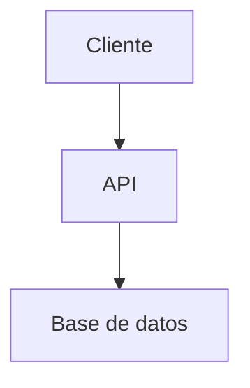
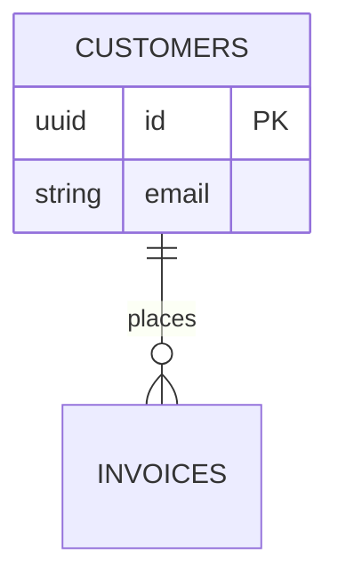

## 1. Contexto

Sistema de pedidos.

## 2. Arquitectura y Stack



Backend NestJS con PostgreSQL.

## 3. Modelo de Datos

```sql
CREATE TABLE users (id UUID PRIMARY KEY);
CREATE TABLE orders (id UUID PRIMARY KEY, user_id UUID);
```



## 4. Contratos de API

POST /api/orders con payload JSON documentado.

```json
{"orderId": "uuid"}
```

## 5. Lógica

Flujo checkout.

## 6. Seguridad

Tokens JWT.

## 7. Infraestructura

Docker Compose.
