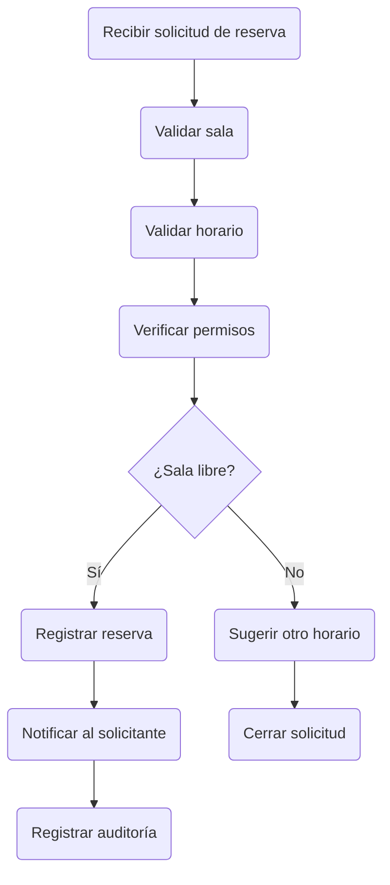

MDD: Reservas (fixture: mermaid TD válido fuera de una sección "Flujo de")

---
## 1. Contexto

Sistema de reservas de salas.
---
## 4. Contratos de API

### Diagrama de reserva

---
## 5. Seguridad

Solo usuarios autenticados reservan salas.