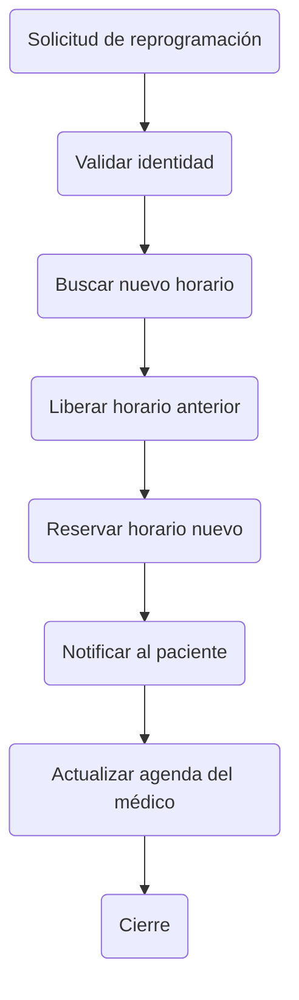

MDD: Agenda de citas (fixture: varias secciones "Flujo de" seguidas)

---
## 1. Contexto

Sistema de citas para una clínica con recordatorios por correo.
---
## 4. Contratos de API

### Flujo de agendado de cita

- Solicitud de cita: el paciente elige especialidad
- Validar datos del paciente
- Consultar disponibilidad del consultorio
- Reservar horario
- Confirmar cita por correo
- Enviar recordatorio 24 horas antes
- Registrar asistencia
- Cierre: marcar la cita como atendida

### Flujo de cancelación

- Paciente solicita cancelar
- Validar ventana de cancelación
- Liberar horario

### Flujo de reprogramación

---
## 5. Seguridad

Los datos clínicos solo los lee el personal asignado.