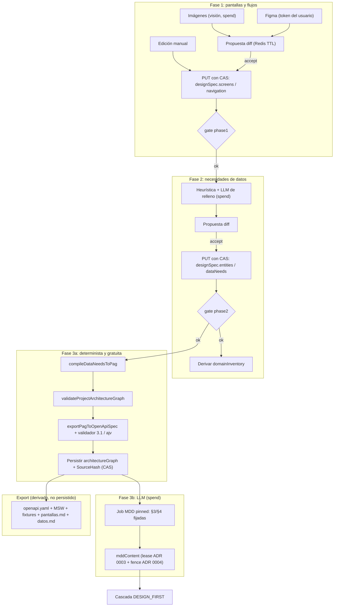
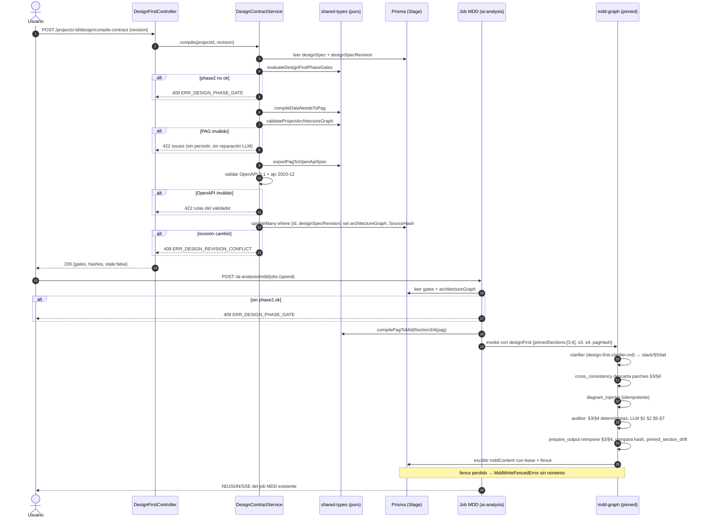

# 03 — Arquitectura y diseño

Volver al [README](./README.md). Requisitos en [01](./01-PRD.md). Archivos en [02](./02-estructura-de-archivos.md). Riesgos y ADR en [06](./06-riesgos-y-decisiones.md).

## Componentes y límites

### Dirección de dependencias

```
ProjectsModule ──► DesignFirstModule ──► FigmaModule
                         │                  └─► CryptoModule
                         ├─► AiModule (visión, propuesta de datos)
                         ├─► EstimationModule (solo depende de Prisma)
                         ├─► UiMcpModule (opcional, Kreo)
                         └─► Prisma
Todos ──► @theforge/shared-types (puro, sin I/O)
```

- DesignFirstModule **no importa** ProjectsModule. ProjectsModule importa DesignFirstModule para la cascada y el handoff. No hay dependencia inversa.
- `EstimationModule` solo depende de Prisma (`estimation.module.ts:6`), así que puede leer columnas nuevas de Stage sin crear un ciclo.
- `ui-mcp` **no se extiende**: maneja instancias de equipo, no credenciales personales. En DESIGN_FIRST, `UiScreensService.syncUiScreens` responde 409 `ERR_DESIGN_FIRST_SCREENS_OWNED`.

### `packages/shared-types/src/design-first/` (puro)

| Archivo | Exporta |
|---|---|
| `design-spec.ts` | Esquemas zod, invariantes I1-I3, hash canónico, `toScreenSpecV1`/`fromScreenSpecV1` |
| `compile-data-needs-to-pag.ts` | `compileDataNeedsToPag` (I4-I6) |
| `compile-pag-to-mdd-sections.ts` | `compilePagToMddSection3`, `compilePagToMddSection4` |
| `export-pag-to-msw.ts` | Handlers MSW v2 como string |
| `build-pag-fixtures.ts` | Fixtures con semilla (I8) |
| `design-first-gates.ts` | `evaluateDesignFirstPhaseGates` (I9) |
| `render-design-markdown.ts` | `pantallas.md`, `datos.md` |
| `../project-type.ts` | `isGreenfield`, `isLegacy`, `isDesignFirst`, `assertNever`: única fuente del enrutamiento por tipo |

shared-types **no depende de `msw`**: los handlers se emiten como strings. El validador OpenAPI/ajv vive en la API, no en shared-types.

### `apps/api/src/modules/design-first/` (DesignFirstModule)

| Pieza | Responsabilidad |
|---|---|
| Controller `projects/:id/design*` | Solo HTTP: valida DTO zod, delega, responde |
| `DesignSpecService` | CRUD con CAS: `updateMany where {id, designSpecRevision}` |
| `DesignProposalService` | Propuestas de diff en Redis con TTL; se aplican con CAS |
| `DesignContractService` | compile-contract y validación OpenAPI 3.1 + ajv |
| `DesignArtifactsService` | Archivos del handoff (OpenAPI, MSW, fixtures, md) |
| `openapi-validate.util.ts` | Esquema propio OpenAPI 3.1 + ajv 2020-12 |
| `data-needs-heuristic.util.ts` | Heurística previa al LLM |

**API pública (exports):** `DesignSpecReader` y `DesignArtifactsService`.

### `apps/api/src/modules/figma/` (FigmaModule)

| Pieza | Responsabilidad |
|---|---|
| `FigmaCredentialService` | Token cifrado por usuario (CryptoModule) |
| `FigmaClient` | `X-Figma-Token`, `GET /v1/files/:key`, `GET /v1/files/:key/nodes?ids=`, timeout, 429/`Retry-After` |
| `figma-to-screens.mapper.ts` | Mapeo determinista y puro a pantallas, con `nodeId` estables |
| `FigmaCredentialController` | `/me/integrations/figma` |

**API pública:** solo `FigmaImportService`. El token nunca sale del módulo.

## Flujo de datos

### Fases y export



1. **Fase 1.** Imágenes, Figma o edición manual producen una propuesta diff; al aceptarla se persiste `designSpec.screens/navigation` con CAS. `phase1` exige: al menos 1 pantalla, I1, rutas únicas y cada pantalla con al menos un componente o `static`.
2. **Fase 2.** La propuesta (heurística y luego LLM de relleno) se acepta y se persiste `designSpec.entities/dataNeeds` con CAS. `phase2` exige I2 e I3, que todo need tenga tipo, que toda acción tenga entidad y que las pantallas con datos remotos tengan estados `empty`, `error` y `loading`. Al cumplirse, se deriva `domainInventory` desde `entities` para los consumidores existentes.
3. **Fase 3a.** `compileDataNeedsToPag` → `validateProjectArchitectureGraph` → `exportPagToOpenApiSpec` (extendido con `operationId`, `example` con semilla y `x-theforge-sources`) → validador 3.1 y ajv. Persiste `architectureGraph` y `architectureGraphSourceHash = designSpecHash` con CAS sobre la revisión.
4. **Fase 3b.** Job MDD existente (`POST /ai-analysis/mdd/jobs`) con `designFirst: {pinnedSections:[3,4], s3, s4, pagHash}`. Sigue el lease del ADR 0003 y el fence del ADR 0004. `mddUpstreamBaseline.designSpec = hash`.
5. **Export.** OpenAPI y MSW/fixtures se derivan siempre de `architectureGraph` y no se persisten.

### compile-contract + job MDD pinned



## Contratos

### `designSpec` (zod en `design-spec.ts`)

Según el dictamen de arquitectura, recomendación 12:

```ts
designSpecSchema = z.object({
  schemaVersion: z.literal(1),
  entities: z.array(entitySchema),
  screens: z.array(screenSchema),
  navigation: z.array(navigationSchema),
  dataNeeds: z.array(dataNeedsSchema),
});

screenSchema = {
  id: /^[a-z][a-z0-9-]{1,63}$/, name, route, roles: [], purpose?, states: [],
  origin: { kind: "image" | "figma" | "manual" | "ui-mcp",
            ref?, nodeId?, fileKey?, sourceImageIndex?, confidence? },
  components: [{ id, component, label?, package?, version?, props }],
};

navigationSchema = { id, from, to, trigger: { componentId?, event }, condition? };

dataNeedsSchema = {
  screenId,
  components: [{ componentId, needs: [{
    id, name, type, format?, origin: "entity" | "derived" | "input",
    action, required, many?, endpointHint?,
    provenance: "heuristic" | "llm" | "user",
  }] }],
  states,
};
```

- Valor inicial al crear: `{schemaVersion:1, entities:[], screens:[], navigation:[], dataNeeds:[]}` con `designSpecRevision = 0` (RF-01).
- Hash canónico: JSON canónico (independiente del orden de claves) antes del hash (RNF-02).
- Adaptadores `toScreenSpecV1`/`fromScreenSpecV1` con roundtrip probado.
- Pantallas agregadas (dashboards): endpoints por recurso por defecto; endpoint de vista `GET /views/{screenId}` solo si el need trae `endpointHint` (decisión Q5).

### Endpoints REST

| Método | Ruta | Nivel | Errores |
|---|---|---|---|
| `POST` | `/projects` (con `projectType=DESIGN_FIRST`) | según creación actual | 400 `ERR_DESIGN_FIRST_DISABLED` (flag apagado); 400 si LEGACY con modo de diseño |
| `GET` | `/projects/:id/design` | `read` | 400 `ERR_DESIGN_FIRST_NOT_ALLOWED` (proyecto no DESIGN_FIRST) |
| `PUT` | `/projects/:id/design/screens` | `contribute` | 409 `ERR_DESIGN_REVISION_CONFLICT`; 422 I1 o referencias colgantes (acepta `cascade=true`); 413 `MAX_SPEC_BYTES`; 503 `ERR_DESIGN_FIRST_DISABLED` |
| `PUT` | `/projects/:id/design/data-needs` | `contribute` | 409 `ERR_DESIGN_REVISION_CONFLICT`; 422 I2/I3; 413 |
| `POST` | `/projects/:id/design/compile-contract` | `contribute` | 409 `ERR_DESIGN_PHASE_GATE`; 409 `ERR_DESIGN_REVISION_CONFLICT`; 422 PAG inválido; 422 OpenAPI inválido |
| `POST` | `/projects/:id/design/proposals/:pid/accept` | `contribute` | 409 `ERR_DESIGN_REVISION_CONFLICT` |
| `POST` | `/projects/:id/design/proposals/:pid/reject` | `contribute` | — |
| `POST` | `/projects/:id/design/import/images` | `spend` | 413 (exceso de imágenes/bytes, antes del LLM); 502 `ERR_DESIGN_EXTRACT_INVALID`; 403 `PROJECT_LEVEL_FORBIDDEN` |
| `POST` | `/projects/:id/design/data-needs/propose` | `spend` | 403 `PROJECT_LEVEL_FORBIDDEN` |
| `POST` | `/projects/:id/design/import/figma` `{fileUrl, nodeIds?}` | `contribute` | 400 `ERR_FIGMA_URL`; 401 `ERR_FIGMA_TOKEN_INVALID`; 412 `ERR_FIGMA_NOT_CONNECTED`; 413 nodos; 422 `ERR_FIGMA_NO_FRAMES`; 503 `ERR_FIGMA_RATE_LIMIT` (`retryAfterSec`) |
| `GET` / `PUT` / `DELETE` | `/me/integrations/figma` | usuario autenticado | El GET devuelve solo `{connected, figmaHandle, lastValidatedAt}` |
| `POST` | `/ai-analysis/mdd/jobs` (existente, con `designFirst`) | según job MDD actual (LLM, `spend`) | 409 `ERR_DESIGN_PHASE_GATE` |
| `GET` | `/projects/:id/openapi.json`, `/openapi.yaml` (existentes) | `read` | Leen primero `architectureGraph` |
| — | Cascada de entregables (existente) | — | 409 `ERR_DESIGN_STALE`; 409 `ERR_DESIGN_PHASE_GATE` |
| — | `syncUiScreens` (ui-mcp) | — | 409 `ERR_DESIGN_FIRST_SCREENS_OWNED` |
| — | Merge de proyectos con DESIGN_FIRST | — | 409 |

Sin SSE nuevo en v1: el compilado del MDD reutiliza el NDJSON y SSE del job MDD. Respuesta de `GET /design`: spec, revisión, `gates: {phase1, phase2, phase3}` (cada una con `ok` e `issues[]` deterministas), hashes y `stale`.

> El plan no fija el código de respuesta cuando una propuesta expiró en Redis (TTL vencido) al hacer `accept`. Definirlo en el paso 16 siguiendo el patrón de errores tipados.

## Modelo de datos y migraciones

| Migración | Carpeta | Contenido | Paso |
|---|---|---|---|
| B (PAG) | `20261104090000_stage_architecture_graph` | `Stage.architectureGraph Json?`, `architectureGraphSourceHash String?` + backfill | 2 |
| A (enum, aislada) | `20261104100000_project_type_design_first` | Solo `ALTER TYPE ... ADD VALUE` | 5 |
| B (diseño) + C | `20261104110000_design_first_spec_figma` | `Stage.designSpec Json?`, `designSpecRevision Int @default(0)`; tabla `UserFigmaCredential` | 5 |

```sql
-- A (aislada: un ADD VALUE no comparte transacción con su uso)
ALTER TYPE "ProjectType" ADD VALUE IF NOT EXISTS 'DESIGN_FIRST';

-- B: backfill idempotente, no toca documentAst
UPDATE "Stage" SET "architectureGraph" = "documentAst"
WHERE "architectureGraph" IS NULL AND "documentAst" ? 'endpoints';

-- C
-- UserFigmaCredential(id, userId UNIQUE, tokenCiphertext, tokenKeyVersion,
--                     figmaHandle?, lastValidatedAt?, createdAt, updatedAt)
```

- Patrón idempotente de `migrations/20261022180000_add_project_approach/migration.sql`; todo replicado en `packages/database/scripts/safe-schema-sync.sql` (RNF-09).
- `Project.figmaMapping` y `uxDesignSource` no se reutilizan; se marcan `@deprecated`.
- Durante una release se mantiene la doble escritura del PAG en `documentAst`; la lectura es `architectureGraph ?? documentAst con endpoints`. El fallback se retira en la release siguiente.

### Reversibilidad: dos releases

| Release | Contenido | Flag |
|---|---|---|
| N | Enum + columnas + lectores tolerantes (un Prisma client viejo no lee un valor de enum desconocido) | `DESIGN_FIRST_ENABLED=false` |
| N+1 | Encendido, con aprobación de Jorge | `DESIGN_FIRST_ENABLED=true` |

- Migraciones forward-only. Bajar de la release N exige `docs/recovery/design-first-rollback.sql`: convierte DESIGN_FIRST → NEW y registra cada fila en una tabla de auditoría.
- Riesgo de despliegue: `docker/entrypoint-full.sh:21` hace `prisma migrate deploy || true` y oculta fallos; tras el deploy hay que verificar el esquema (ver [06](./06-riesgos-y-decisiones.md#riesgos)).

## MDD compilado en modo pinned

- **Mismo grafo** (`mdd-graph.ts`), con estado `designFirstPinned`. No se crea un grafo nuevo.
- **Nodos saltados:** `data_model`, `data_model_patch`, `architect_critic` y `api_contracts`. `routeAfterStackArchitectOneShot` salta a `section5`/tail.
- **Rutas de reparación cerradas:** `routeAfterPrepareOutput` (`mdd-graph.ts:485-495`) hoy puede volver a `data_model` o `api_contracts`; en pinned redirige esos fix targets al clarifier o corta con gap HITL.
- **`cross_consistency`** descarta los parches que tocan §3/§4.
- **Diagram injector no se salta**: el compilador emite el erDiagram con el mismo util que usa el injector (`nodes/mdd-diagram-injector.node.ts:41`), así que el injector es idempotente.
- **Barrera por hash en `prepare_output`:** reimpone §3/§4 desde los snapshots (`dataModelArchitectMddDraftSnapshot`, `apiContractsArchitectMddDraftSnapshot`, `utils/mdd-section-preserve.util.ts:143-144`), compara hashes y emite la métrica `pinned_section_drift`.
- **Auditor determinista para §3/§4:** puntúa por cobertura; el LLM solo puntúa §1, §2 y §5-§7. Un gap en §3/§4 se traduce en "volver a fase 2". Evita que `entityHasRichProseInSection3` (`engine/mdd-quality-audit.util.ts:16`) penalice una §3 compilada.
- **Prompt nuevo** `ai-analysis/prompts/design-first-clarifier.md`: el Clarifier recibe pantallas, flujos y PAG como datos delimitados de solo lectura.
- **Sin pase LLM de prosa** sobre §3/§4 en v1 (decisión Q9).
- **Lease y fence intactos:** solo `mddContent` pasa por `claimMddWriteFence`. Un fence perdido → `MddWriteFencedError` sin reintento. Un abort después de §2 deja el Stage intacto.

### Compiladores §3/§4 nuevos

`compilePagToPersistenceMarkdown` (`document-compiler.ts:74-109`) emite un H1 propio y tablas markdown, y el harness espera en §3 bloques `CREATE TABLE` y un erDiagram derivado del SQL (`mdd-diagram-injector.node.ts:41`, `mdd-architect-critic-outline.util.ts:68`, `mdd-auditor-gaps.util.ts:148`). Por eso:

- `compilePagToMddSection3`: `CREATE TABLE` + prosa mínima por entidad generada por plantilla + erDiagram con el util del injector.
- `compilePagToMddSection4`: tablas en el formato que validan `validateApiTablesSyntax` (`engine/mdd-pre-render.ts:124`) y `extractMddSection4Endpoints` (`engine/conformance.service.ts:294`). Los endpoints extraídos son exactamente los del PAG.

## PAG sin singleton

- Se elimina `AiService.lastGeneratedPag` (`ai.service.ts:369-372, :817`).
- `generateProjectArchitectureGraph` devuelve el PAG; el generador lo persiste en `Stage.architectureGraph`.
- Logic flows (`ai.service.ts:1587`) e infra (`:1766`) lo reciben por argumento, leído de Stage.
- En DESIGN_FIRST nunca se llama al PAG con LLM: `compileDataNeedsToPag` es 100 % determinista y falla cerrado (sin el self-healing "mejor esfuerzo" de `ai.service.ts:805-810`).

## OpenAPI, MSW y fixtures

| Pieza | Detalle |
|---|---|
| OpenAPI 3.1 | `exportPagToOpenApiSpec` extendido con `operationId`, `example` con semilla y `x-theforge-sources`; sin cambio para PAG sin fuentes (OpenAPI de NEW idéntico, golden de regresión). Validación: esquema propio de estructura 3.1 + `ajv` + `ajv-formats` (JSON Schema 2020-12). |
| MSW | Sintaxis v2 (`http`, `HttpResponse`); rutas `{id}` → `:id`. Variantes `empty` y `error` seleccionadas por el header `x-mock-state`. Emitido como string. |
| Fixtures | Con semilla, referencialmente consistentes (FK), I8. |
| Handoff | `openapi.yaml`, `mocks/handlers.ts`, `mocks/browser.ts`, `mocks/fixtures/*.json`, `mocks/README.md` (fija `msw@^2`), `docs/sdd/pantallas.md`, `docs/sdd/datos.md`. |

## Semáforo por fases

- `getLiveMetricsForProject` añade una rama `isDesignFirstProjectType`: carga `designSpec` y `architectureGraph`, y calcula `phaseStatus = evaluateDesignFirstPhaseGates(...)`.
- Regla: `status = min(phaseStatus, mddStatus)` si hay MDD; si no, `phaseStatus` con **tope AMARILLO**.
- ROJO si `phase1` no está ok; AMARILLO si falta `phase2`, `phase3` o frescura de hashes; VERDE solo con `phase3` ok, MDD fresco y puertas actuales del MDD en verde.
- La condición `content.trim().length > 0` (`estimation.service.ts:1190`) pasa a `hasEvaluableInput`, para que se escriba `Stage.status` también sin MDD. Solo lo escribe `getLiveMetricsForProject`.
- `resolveScreenCount(stage, mdd, projectType)` es el único resolutor del conteo; lo usan los tres sitios actuales (`:480-512`, `:599-651`, `:1443`). En DESIGN_FIRST = `designSpec.screens.length`.
- `precisionScore` en fases 1-2: porcentaje de completitud con **tope 40** (Q6). Estimación no disponible hasta la fase 3 (Q7).
- `computeCostEstimation` y `packages/business-rules` no cambian.

## Cascada DESIGN_FIRST

`DELIVERABLE_WAVES_DESIGN_FIRST_BY_COMPLEXITY` en `deliverables-matrix.ts`; `resolveDeliverableWaves` recibe `projectType`. La complejidad se sigue infiriendo como hoy (Q8).

| Complejidad | Oleadas |
|---|---|
| HIGH | `[["mdd_canonical"], ["spec","architecture"], ["use_cases","user_stories","api_contracts","logic_flows","ux_ui_guide","blueprint"], ["design_screens_render"], ["tasks","infra","agent_governance"]]` |
| LOW / MEDIUM | Iguales a HIGH sin `mdd_canonical` ni `architecture` |

- Precondición: `phase3.ok` y no `stale`; si no, 409 (`ERR_DESIGN_PHASE_GATE` / `ERR_DESIGN_STALE`).
- `api_contracts` se compila desde `architectureGraph` sin LLM; `uiScreensContent` se renderiza desde `designSpec` (`design_screens_render`). Un fallo ahí **falla cerrado** (hoy `ui_screens_sync` traga errores en `deliverables-cascade.service.ts:126-133`).
- `getMddDependentKeys(projectType)`: limpiar entregables dependientes nunca borra `designSpec` ni `architectureGraph`.

## Workshop (web)

- Pestañas `Pantallas`, `Datos` y `Contrato` cuando `projectType === DESIGN_FIRST` (`utils/complexityTabs.ts`, `utils/workshopDocNav.ts`).
- Paneles en `views/workshop/design/`: `WorkshopDesignScreensPanel`, `WorkshopDesignDataNeedsPanel`, `WorkshopDesignContractPanel`, `DesignProposalDiffDialog`.
- Slice `store/workshop/slice-design.ts` con `revision`; un 409 de revisión recarga y avisa. Cliente API encapsulado.
- Puertas de fase en la columna de métricas (`views/WorkshopMetricsColumnInner.tsx`).
- Estados de carga, error y vacío explícitos; textos en español; formularios con zod de shared-types.
- El JSON crudo de visión o LLM nunca se muestra: se presenta como diff.
- `FigmaCredentialSettings.tsx` en ajustes de usuario; el token no se vuelve a mostrar.

## Seguridad

- **Token Figma:** cifrado AES-256-GCM con `TokenCryptoService` (`crypto/token-crypto.service.ts:13,:31`, `TOKEN_MASTER_KEYS`), columnas `tokenCiphertext`/`tokenKeyVersion` como `UiMcpInstance` y `UserProviderConfig`. Nunca en logs, trazas, TokenUsage ni respuestas. Entra en `scripts/rotate-master-key.ts` (y se agrega `UiMcpInstance`, deuda previa de `:87-110`).
- **SSRF:** base URL fija `FIGMA_API_BASE_URL` validada como https; el `fileKey` se valida con regex.
- **Inyección:** el texto de Figma y de las imágenes se delimita como dato en los prompts; la regla "no inventar campos" es código, no prompt.
- **Límites:** tamaño de spec, pantallas, imágenes y nodos Figma (ver [Flags y config](#flags-y-config)); se rechaza con 413/422 antes de llamar al LLM.
- **Autorización:** ADR 0001 con `@ProjectScoped`; `route-coverage.spec.ts` falla si una ruta queda sin decorar.
- **Figma resiliente:** timeout por petición, `Retry-After` en 429 con 2 reintentos y backoff exponencial, concurrencia limitada por usuario.

## Observabilidad

- TokenUsage con `documentField` nuevos `designScreenSpec` y `designDataNeeds`, y `context: "design_first"`; también se registra en salida de visión inválida (CL-09).
- Métrica `pinned_section_drift` en el compilado del MDD.
- Visión: structured output zod, una reparación, `deadlineMs`, `sourceImageIndex`/`confidence` por pantalla.

## Flags y config

Todas en `apps/api/src/config/env.schema.ts` (config tipada; nada de `process.env` disperso).

| Variable | Default | Validación |
|---|---|---|
| `DESIGN_FIRST_ENABLED` | `false` | booleano |
| `FIGMA_API_BASE_URL` | `https://api.figma.com` | URL https obligatoria |
| `DESIGN_FIRST_FIGMA_TIMEOUT_MS` | definido en el paso 1 | validado en `env.schema.ts` (RNF-05) |
| `DESIGN_FIRST_FIGMA_MAX_NODES` | 5000 | entero positivo |
| `DESIGN_FIRST_VISION_BUDGET_MS` | definido en el paso 1 | presupuesto < 15000 inválido |
| `DESIGN_FIRST_DATANEEDS_BUDGET_MS` | definido en el paso 1 | presupuesto < 15000 inválido |
| `DESIGN_FIRST_MAX_IMAGES` | 8 (≤ 5 MB cada una) | entero positivo |
| `DESIGN_FIRST_MAX_SPEC_BYTES` | 512 KB | entero positivo |
| `COMPILER_FIRST_*` | los actuales | se mueven a `env.schema.ts`; hoy se leen fuera de config (`ai.service.ts:1442,:1500,:1582,:1761`) |

Límite fijo adicional: ≤ 200 pantallas (RNF-04). El plan no fija los valores por defecto de los presupuestos en ms; para `DESIGN_FIRST_VISION_BUDGET_MS` y `DESIGN_FIRST_DATANEEDS_BUDGET_MS` solo fija el mínimo (< 15000 es inválido).

## Invariantes

| ID | Invariante | Dónde se evalúa |
|---|---|---|
| I1 | Ids de pantalla, componente y arista únicos; rutas únicas; toda arista de navegación apunta a pantallas existentes. | `design-spec.ts`, `PUT screens`, gate `phase1` |
| I2 | Integridad referencial de `dataNeeds`: cada `screenId`/`componentId` existe; toda acción referencia una entidad existente. | `design-spec.ts`, gate `phase2` |
| I3 | Tipos de `dataNeeds` completos y coherentes: todo need tiene tipo y el mismo campo no aparece con tipos contradictorios. | `design-spec.ts`, gate `phase2` |
| I4 | `compileDataNeedsToPag` es determinista: misma entrada canónica → mismos bytes. | `compile-data-needs-to-pag.ts` |
| I5 | Todo endpoint y entidad del PAG trazan a una pantalla o need de origen (fuentes). | `compile-data-needs-to-pag.ts` |
| I6 | Las referencias internas del PAG son válidas (`validateProjectArchitectureGraph` sin issues). | compile-contract |
| I7 | El OpenAPI emitido es 3.1 válido (esquema propio + ajv 2020-12). | `openapi-validate.util.ts` |
| I8 | Las fixtures son referencialmente consistentes (FK que apuntan a filas existentes). | `build-pag-fixtures.ts` |
| I9 | Las puertas `phase1/2/3` son deterministas y gobiernan compile-contract, job MDD, cascada y semáforo. | `design-first-gates.ts` |

> El plan agrupa I4-I6 como "PAG determinista y referencias" sin desglosarlas una por una. El reparto I4/I5/I6 de esta tabla es la lectura de este documento; confirmarlo al escribir las specs del paso 7.

## Patrones de arquitectura aplicados

| Patrón (`~/.claude/rules/arquitectura/`) | Cómo se aplica | Desviaciones declaradas |
|---|---|---|
| `backend-nestjs.md` | Módulos por dominio con API pública mínima (`DesignSpecReader`, `DesignArtifactsService`, `FigmaImportService`); controller → servicio → util puro; DTOs zod en el borde; errores tipados (409 CAS, 422 referencias colgantes); config tipada; README por módulo nuevo; specs colocados. | Prisma en lugar de TypeORM (manda el repo). Los errores usan `BadRequestException`/`ConflictException` de Nest como el resto del repo. |
| `monorepo-paquetes.md` | Contratos en `@theforge/shared-types`; la web deja de duplicar tipos (`App.tsx`, `ProjectFolderTile.tsx`, `store/workshop/types.ts`); shared-types no depende de `msw`; build en orden con `pnpm run typecheck`. | — |
| `frontend-react-vite.md` | Estado de servidor en slice Zustand con revisión y cliente API encapsulado; formularios con zod de shared-types; textos en español; estados de carga, error y vacío. | Sin TanStack Query: el repo no lo usa. |
| `mcp-y-agentes-ia.md` | Gates deterministas (fases 1-2, I1-I9) antes de cualquier LLM; salida LLM validada con zod y una sola reparación; timeouts y abort; telemetría por llamada; sin lógica en prompts; el JSON crudo no llega al usuario (diff); MCP Kreo opcional que degrada sin bloquear. | — |
| `docker-dokploy.md` | Migraciones idempotentes. | El `\|\| true` de `docker/entrypoint-full.sh:21` queda como riesgo (no se corrige en este paquete). |

## Alternativas descartadas

| Alternativa | Motivo |
|---|---|
| `approach: DESIGN_FIRST` | La excluye la decisión D1. |
| Grafo `mdd-design-first-graph` nuevo | Duplica la topología y las specs. |
| PAG con LLM a partir de DataNeeds | No es determinista y crea un ciclo con las ediciones de fase 2. |
| Tres columnas Json separadas | Pierden la integridad referencial atómica. |
| Extender `ui-mcp` con Figma | Ese módulo maneja instancias de equipo, no credenciales personales. |
| Visión como turno del chat que persiste directo | No se puede validar y contamina `lastUserMessage`. |
| Reutilizar `UserProviderConfig` para Figma | Sus columnas son de LLM. |
| Reutilizar `compilePagToPersistenceMarkdown`/`compilePagToApiContractsMarkdown` para §3/§4 | Emiten H1 propio y no emiten `CREATE TABLE` ni erDiagram. |

## Dictámenes de expertos

**`experto-arquitectura`: viable con condiciones.**
1. Corregir primero `documentAst` y `lastGeneratedPag` con `Stage.architectureGraph`, y encapsular el enum en helpers antes de añadir el valor.
2. Módulo `design-first/` (Projects → DesignFirst, sin import inverso) y `figma/` separado de `ui-mcp`; compiladores puros en shared-types; validador OpenAPI/ajv en api.
3. Documento único `Stage.designSpec` con `designSpecRevision` para CAS; invalidación por cadena de hashes calculada al leer; `UserFigmaCredential` por usuario.
4. Enum en migración aislada, dos releases y flag; down-script DESIGN_FIRST → NEW con tabla de auditoría.

**`experto-ia-agentica`: viable con condiciones.**
1. PAG 100 % determinista (`compileDataNeedsToPag`) que falla cerrado, sin reparación LLM.
2. Visión → ScreenSpec v2 por endpoint dedicado con propuesta diff y aceptación HITL; zod, una reparación, `deadlineMs`, telemetría `designScreenSpec`, `sourceImageIndex`/`confidence`.
3. MDD con el grafo actual en `pinnedSections: [3,4]`; saltar `data_model`, `data_model_patch`, `architect_critic`, `api_contracts`; cerrar rutas de reparación; barrera por hash; `cross_consistency` filtra; Auditor determinista en §3/§4 y gap → "volver a fase 2".
4. Figma por mapeo determinista con `nodeId` estables; texto de Figma e imágenes tratado como dato.

Se omitió `experto-backend-nestjs` por `MAX_EXPERTOS: 2`; arquitectura cubrió módulos, guards y CAS.

### Conflictos y resolución adoptada

| # | Tema | Postura IA | Postura arquitectura | Resolución |
|---|---|---|---|---|
| 1 | Escrituras de diseño y fence del MDD | Toda escritura en Stage pasa por `claimMddWriteFence` | CAS por `designSpecRevision`, sin lease; solo `mddContent` por fence | **Arquitectura.** El ADR 0004 acota el fence al MDD; atar la edición al lease la bloquearía durante la compilación. `mddUpstreamBaseline` marca el MDD obsoleto por hash sin carrera. |
| 2 | Reutilizar compiladores existentes para §3/§4 | Válido (sin verificar) | — (verificado por el planificador: no encaja) | **Compiladores nuevos** `compilePagToMddSection3/4`. |
| 3 | DESIGN_FIRST en `ProjectType` o `approach` | Prefería `approach`, no reabre | Acepta `ProjectType` | **`ProjectType`** (decisión D1), con helpers de `project-type.ts` como única fuente. |
| 4 | Diagram injector con §3 fijada | Saltarlo | No lo trató | **No saltarlo**: mismo util de ER; la barrera de `prepare_output` corrige deriva y emite `pinned_section_drift`. |
