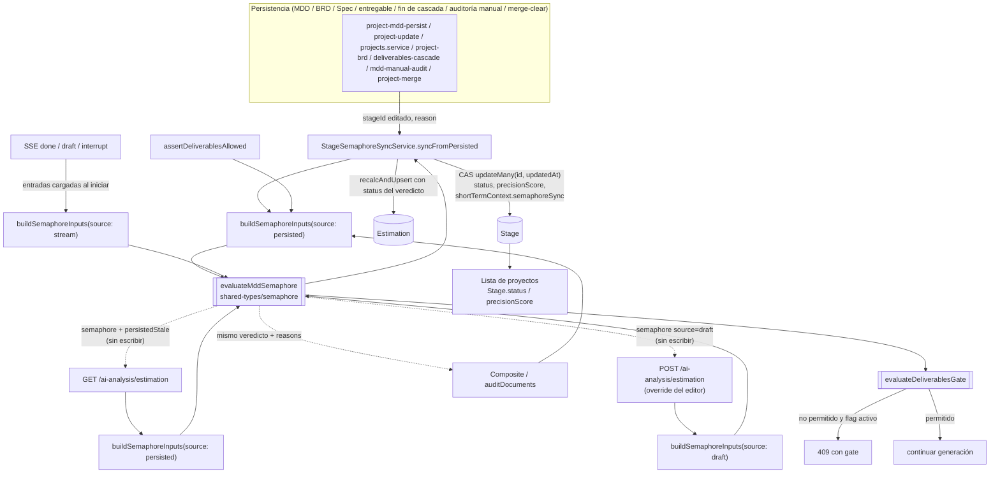

# 03 — Arquitectura y diseño

[← README](./README.md) · Anterior: [01-PRD.md](./01-PRD.md) · Siguiente: [02-estructura-de-archivos.md](./02-estructura-de-archivos.md)

## 1. Componentes y límites

| # | Componente | Ubicación | Responsabilidad | Límite |
|---|---|---|---|---|
| 1 | **Núcleo puro** | `packages/shared-types/src/semaphore/` | Escala y umbrales; `resolveCompletenessPhase` + `DOC_WEIGHTS_BY_PHASE`; `computeIntegralScore`; `evaluateMddSemaphore(input) → MddSemaphoreVerdict`; `evaluateDeliverablesGate`; zod `mddSemaphoreVerdictSchema`; `normalizeMddForHash` (quita cabecera de fecha, aplica `formatDocumentMarkdown`, colapsa espacios). | Sin `node:*`, Prisma ni Nest (RNF-02). El hash con `node:crypto` queda en la API. |
| 2 | **Extractores** (API) | `estimation/mdd-section-detectors.util.ts` (nuevo, desde `estimation.service.ts:113-191` y `:531-599`); `engine/mdd-internal-audit.util.ts`; `estimation/consistency.util.ts` y `brd-mdd-traceability.util.ts`; `validateMddForDelivery` + `resolveDeliveryGateContext`; `ConformanceService` y gaps en `engine/conformance-gaps.util.ts` | Convierten documentos en números/gaps. | No deciden color. |
| 3 | **Fábrica de entradas** | `estimation/semaphore-inputs.factory.ts` (exportada por la API pública de estimation) | `buildSemaphoreInputs({ projectId, stageId, content, source })` carga etapa y proyecto una vez; resuelve perfil (`HIGH|MEDIUM|LOW|DESIGN_FIRST|LEGACY`), `derivativesState`, gaps del Auditor por hash, contexto del gate, resumen de conformidad y gaps cruzados deduplicados. | Solo lectura. |
| 4 | **`EstimationService`** | `estimation/estimation.service.ts` | `calculateLiveMetrics` y `getLiveMetricsForProject` son fachadas fábrica → núcleo → costo. `evaluateForStream`. | **No escriben.** Se eliminan `syncStageSemaphoreFromLiveMetrics` y la rama DF paralela. |
| 5 | **`StageSemaphoreSyncService`** | `projects/stage-semaphore-sync.service.ts` (nuevo) | Único escritor de `Stage.status`/`precisionScore`/`shortTermContext.semaphoreSync`. | Inyecta `EstimationService` desde `EstimationModule` (que solo depende de Prisma), **no** de AiAnalysis. |
| 6 | **Composite** | `projects/project-semaphore-composite.util.ts` | Adaptador: devuelve `status`/`precisionScore` del veredicto + `reasons` y conteos. | No calcula color propio. |
| 7 | **`SemaphoreService`** | `engine/semaphore.service.ts` | Solo degradadores puros `figmaGateOk` y Constitución con bloqueantes abiertos (J9). | Se retiran buckets 70/82/92/95, `applySddPrecisionGates`, `edge_cases`/`field_types`, alivio `sddDomainGraphOk`. |
| 8 | **Puerta de entregables** | `projects/project-deliverable-gate.service.ts` (`assertDeliverablesAllowed`, :68, 8 callers) | Recalcula veredicto persistido y aplica `evaluateDeliverablesGate` tras flag `DELIVERABLES_GATE_REQUIRE_GREEN` (default false). Con flag apagado solo exige blockers, pero la respuesta ya expone la regla. | Conserva el 409 actual. |
| 9 | **Web** | `apps/web/src/...` | Solo refleja `semaphore`. | Sin lógica de color ni de puerta. |

## 2. Flujo de datos



Resumen textual:

```
Persistir (MDD/BRD/Spec/entregable/cascada/auditoría/merge)
  → StageSemaphoreSyncService.syncFromPersisted(projectId, stageId editado, {reason})
      → buildSemaphoreInputs(source:'persisted') → evaluateMddSemaphore
      → CAS updateMany(Stage{id, updatedAt}) {status, precisionScore, shortTermContext.semaphoreSync{version:1, inputsHash, computedAt}}
      → recalcAndUpsert(Estimation, status del veredicto)
Panel POST (borrador)   → source:'draft' → núcleo → respuesta (sin escribir)
Panel GET               → source:'persisted' → núcleo → respuesta + persistedStale (sin escribir)
Stream done/interrupt   → entradas cargadas al iniciar (source:'stream') → núcleo
Composite / auditDocuments → buildSemaphoreInputs(persisted) → mismo veredicto + reasons
Puerta backend          → veredicto persistido → evaluateDeliverablesGate → 409 o continuar
Lista de proyectos      → Stage.status / precisionScore (escritos solo por el sync)
```

**Invariante (ADR-0007):** con las mismas entradas persistidas, panel GET = lista = composite = puerta. El POST con borrador puede diferir y la UI lo marca con `source==='draft'`.

## 3. Contratos

### 3.1 `MddSemaphoreVerdict` (`packages/shared-types/src/semaphore/verdict.schema.ts`)

```ts
type SemaphoreStatus = "red" | "yellow" | "green";
type CompletenessPhase = "pre_cascade" | "post_cascade";
type DerivativesState = "none" | "partial" | "complete";
type MddSemaphoreVerdict = {
  version: 1;
  status: SemaphoreStatus;
  headline: number;                         // 0–100 titular
  headlineSource: "auditor" | "integral" | "design_first_phases";
  integral: number | null;
  components: { completeness: number; consistency: number | null; mddQuality: number };
  phase: CompletenessPhase;
  derivativesState: DerivativesState;
  reasons: string[];                        // por qué no es verde / es rojo
  notes: string[];                          // p. ej. "MDD listo; genera entregables"
  source: "persisted" | "draft" | "stream";
  deliverablesGate: { allowed: boolean; rule: "high"|"low_medium"|"design_first"|"legacy"; reasons: string[] };
};
```

Se acompaña de `mddSemaphoreVerdictSchema` (zod) para validar en bordes (respuesta HTTP, SSE, backfill).

### 3.2 `LiveMetricsResult` (`estimation/estimation.types.ts`)

- Suma `semaphore: MddSemaphoreVerdict` y `persistedStale?: boolean`.
- Alias `@deprecated` (J15, RNF-04), se retiran en la siguiente versión tras migrar web y MCP `get_estimation`:
  - `status = semaphore.status`
  - `precision = semaphore.integral ?? semaphore.headline`
  - `auditorScore`, `mddQualitySource`, `deliveryGate` (se conservan con su forma actual).

```ts
interface LiveMetricsResult {
  semaphore: MddSemaphoreVerdict;
  persistedStale?: boolean;
  /** @deprecated usar semaphore.status */ status: SemaphoreStatus;
  /** @deprecated usar semaphore.integral ?? semaphore.headline */ precision: number;
  /** @deprecated */ auditorScore?: number | null;
  /** @deprecated */ mddQualitySource?: string;
  /** @deprecated */ deliveryGate?: unknown; // forma actual
  // … resto de campos actuales (costo, desglose)
}
```

### 3.3 Respuesta `GET/POST /ai-analysis/estimation`

- Ambos devuelven `semaphore` y `persistedStale` (este último solo tiene sentido en GET; en POST `semaphore.source === 'draft'`).
- `semaphore.deliverablesGate` incluido (P8 o P10).
- GET (`READ_QUERY`) y POST (`CONTRIBUTE_BODY`) **no escriben** (RF-12, RNF-06).

### 3.4 SSE

Los eventos `done`, `draft` e `interrupt` suman `semaphore: MddSemaphoreVerdict` con `source: 'stream'`. La web lo consume en `apps/web/src/store/workshop/helpers/mdd-chat-event.ts`.

### 3.5 Cuerpo 409 (`buildMddDeliveryGateConflictBody` en `utils/mdd-delivery-gate-guard.util.ts`)

```ts
{
  code: "ERR_MDD_DELIVERY_GATE" | "ERR_DELIVERABLES_GATE", // nuevo código cuando el motivo NO es un blocker del MDD
  // … campos actuales del cuerpo
  gate: {
    allowed: boolean;
    rule: "high" | "low_medium" | "design_first" | "legacy";
    reasons: string[];
    semaphoreStatus: SemaphoreStatus;
    hasSpec: boolean;
  };
}
```

Se conserva `ERR_MDD_DELIVERY_GATE` para blockers del MDD; `ERR_DELIVERABLES_GATE` es nuevo para falta de verde/Spec/bootstrap.

### 3.6 `evaluateDeliverablesGate` (`semaphore/deliverables-gate.ts`)

```ts
function evaluateDeliverablesGate(input: {
  profile: "HIGH" | "MEDIUM" | "LOW" | "DESIGN_FIRST" | "LEGACY";
  verdict: Pick<MddSemaphoreVerdict, "status" | "reasons">;
  hasSpec: boolean;
  hasBootstrap: boolean;        // DBGA o MDD (LOW/MEDIUM)
  legacyHasDoc: boolean;        // MDD o codebaseDoc
  designFirstGateOk: boolean;   // resultado de assertDesignFirstDeliverableGate
}): { allowed: boolean; rule: "high" | "low_medium" | "design_first" | "legacy"; reasons: string[] };
```

| Perfil | Regla | `allowed` cuando |
|---|---|---|
| HIGH | `high` | delivery gate ok **y** verde **y** Spec presente |
| LOW / MEDIUM | `low_medium` | bootstrap (DBGA o MDD) **o** verde con Spec |
| DESIGN_FIRST | `design_first` | `assertDesignFirstDeliverableGate` ok |
| LEGACY | `legacy` | MDD o `codebaseDoc` presente |

### 3.7 `readiness-audit.util.ts`

Topes `READINESS_*_AMARILLO_CAP` quedan exportados `@deprecated`; `applyCompositeReadinessGates` se reemplaza por el núcleo.

## 4. Escala única y umbrales

| Regla | Valor | Efecto |
|---|---|---|
| Rojo | titular <85 | rojo |
| Amarillo | 85 ≤ titular <90 | amarillo |
| Verde (puntaje) | titular ≥90 | candidato a verde |
| Consistencia BRD→MDD | ≥90 si se mide; neutra sin BRD | si <90 → máx. amarillo |
| Gaps cruzados deduplicados (solo `post_cascade`) | ≤5 | más → máx. amarillo |
| Conformidad (solo con derivados presentes) | `ok:false` o >3 endpoints faltantes | máx. amarillo |
| Blocker del delivery gate | ≥1 | rojo |
| Auditor vigente | `critical_gaps=0` (y `infrastructure_ready` en HIGH) | si no → máx. amarillo |
| Degradadores HIGH (Figma/UX, bloqueantes Constitución) | falla | máx. amarillo |
| Tope DF | fases 2/3 no ok → `headline=min(headline,40)` y máx. amarillo; fase 1 no ok → rojo | única excepción documentada |
| Topes 78/82/85 del composite | retirados | — |

**Las razones nunca bajan el titular; solo limitan el color** (excepción: tope DF).

Orden de evaluación en `evaluateMddSemaphore`: puntaje → gate → conformidad y gaps → tope DF → derivados → puerta. Propiedad verificada por spec: **ninguna regla sube el color** (el rango resultante ≤ el rango del puntaje).

Reglas retiradas (J12): «>8 endpoints faltantes → rojo», tolerancia separada de gaps humanos (>3 → amarillo 78), `conformancePenalty`, regla «>5».

## 5. Modelo de completitud por fase

### 5.1 `derivativesState` por perfil

Un derivado cuenta como presente si su contenido supera `MIN_DERIVATIVE_DOC_LENGTH` = 80 caracteres.

| Perfil | Derivados que cuentan |
|---|---|
| HIGH | Blueprint, API, Flujos, Infra |
| MEDIUM | (Spec **o** casos de uso), API, (UX **o** Flujos), HU, tasks |
| LOW | HU, tasks |
| DESIGN_FIRST | Igual que HIGH tras fase 3 |

- `none`: ninguno presente.
- `complete`: todos presentes.
- `partial`: el resto.

`post_cascade` ⇔ `derivativesState === 'complete'`. Cualquier otro estado es `pre_cascade`.

### 5.2 Pesos y fórmulas

- **Pre-cascada:** MDD 0.50, BRD 0.30, Spec 0.20. En HIGH la ausencia de BRD/Spec penaliza; en LOW/MEDIUM se renormaliza sobre los documentos presentes (J10).
- **Post-cascada:** `DOC_WEIGHTS` actual (11 documentos).
- Puntaje por documento 100/50/10/0 (sin cambios).
- Completitud `C = Σ(peso_i · puntaje_i) / Σ(peso_i)` (la suma del denominador cubre todos los documentos de la fase en HIGH y solo los presentes en LOW/MEDIUM pre-cascada).
- Integral con BRD: `integral = 0.30·C + 0.25·T + 0.45·Q` (T = consistencia/trazabilidad BRD→MDD; Q = calidad del MDD).
- Integral sin BRD: `integral = (0.30·C + 0.45·Q) / 0.75` (T = `null`, no medida).

Ejemplos de aceptación (RF-02, CL-02):
- Pre-cascada, MDD perfecto + BRD + Spec, T = 100, Q = 100 → `C = 100`, integral 100 → verde.
- HIGH, MDD + BRD sin Spec, T = 100, Q = 100 → `C = 80` → `0.30·80 + 25 + 45 = 94` → verde.
- HIGH, sin BRD, MDD perfecto y Spec → `C = 70` → `(0.30·70 + 45)/0.75 = 88` → amarillo.

### 5.3 Conformidad y gaps cruzados por estado

| `derivativesState` | Conformidad y gaps cruzados | Nota |
|---|---|---|
| `none` | No se evalúan | «MDD listo; genera entregables» |
| `partial` | Solo sobre derivados presentes | «cascada incompleta» |
| `complete` | Todo | — |

Mientras haya job de cascada activo el sync no escribe; el fin de cascada dispara el sync.

## 6. Sincronización CAS (único escritor)

```ts
StageSemaphoreSyncService.syncFromPersisted(
  projectId: string,
  stageId: string,
  opts?: { reason: string },
): Promise<{ status: SemaphoreStatus; precisionScore: number; changed: boolean } | null>;
```

- Lee `Stage.updatedAt` junto con las entradas.
- Escribe con `updateMany({ where: { id: stageId, updatedAt } })`. Si afecta 0 filas, reintenta **una vez** releyendo; si vuelve a fallar, log `[Semaphore] cas-miss`.
- Escribe solo si hay diferencia.
- Guarda `shortTermContext.semaphoreSync = { version: 1, inputsHash, computedAt }` (J14, sin migración).
- Luego `recalcAndUpsert(Estimation, status del veredicto)`.
- No escribe mientras haya job de cascada o lease activo.

**Callers (siempre con la etapa editada):**

| Archivo | Puntos |
|---|---|
| `projects/project-mdd-persist.service.ts` | :329, :456 |
| `projects/project-update.service.ts` | :354, :416 |
| `projects/projects.service.ts` | :252 |
| `projects/project-brd.service.ts` | :122 |
| `stage-deliverable-persist.util.ts` (`persistStageAndProjectDeliverables`) | vía hook del servicio llamador |
| `projects/deliverables-cascade.service.ts` | :211, :410, :843, :917 — solo al final o en error |
| `ai-analysis/mdd/mdd-manual-audit.service.ts` | tras `saveMddAuditSnapshot` |
| `projects/project-merge.service.ts` | :358, :388 |

`refreshStageSemaphoreFromProject` queda como wrapper `@deprecated` que delega con la etapa primaria (solo para callers sin etapa).

**Red de seguridad:**
1. Spec de inventario (`stage-semaphore-writers.inventory.spec.ts`, grep en test) que falla si aparece una escritura nueva de `mddContent`, `brdContent` o `specContent` fuera de la lista permitida.
2. `persistedStale` en GET (compara `inputsHash` persistido con el actual, sin escribir).
3. Script de backfill `apps/api/scripts/recalc-stage-semaphores.ts`.

## 7. Puerta compartida y flag

- `evaluateDeliverablesGate` vive en shared-types (sección 3.6).
- `assertDeliverablesAllowed` (`project-deliverable-gate.service.ts:68`, 8 callers) recalcula el veredicto persistido y aplica la regla **tras el flag** `DELIVERABLES_GATE_REQUIRE_GREEN`:
  - Flag apagado (default, J11): comportamiento actual (solo blockers del delivery gate); la respuesta ya expone `deliverablesGate`.
  - Flag encendido: aplica la regla completa; si no se permite → 409 con `gate`.
- `acknowledgeGaps` salta blockers del MDD y la falta de verde (con log); **no** salta la falta de Spec en HIGH (J13).
- La web usa `semaphore.deliverablesGate.allowed` para `canGenerate`.

## 8. Seguridad y permisos

- `GET /ai-analysis/estimation` (`READ_QUERY`) y `POST` (`CONTRIBUTE_BODY`) no escriben en BD (RF-12, RNF-06).
- El backfill solo se ejecuta por CLI, nunca en el arranque de la API.
- El flag de puerta solo afecta al backend; la web no decide permisos.
- Los logs nunca incluyen contenido del MDD.

## 9. Observabilidad

- `logger.log('[Semaphore] …')` por cada evaluación persistida con: `projectId`, `stageId`, `source`, `status`, `headline`, `headlineSource`, `phase`, `derivativesState`, `reasons.length`, `changed`, `durationMs`, `reason`.
- `[Semaphore] gate-block` con `rule` y `reasons` por cada bloqueo de puerta.
- `[Semaphore] cas-miss` cuando el CAS falla dos veces.
- Medición de p95 del POST en P5 (RNF-01).

## 10. Flags y configuración

| Nombre | Tipo | Default | Dónde | Efecto |
|---|---|---|---|---|
| `DELIVERABLES_GATE_REQUIRE_GREEN` | booleano (env) | `false` | Config tipada de la API (`apps/api/src/config/`; candidato `env.schema.ts`, ver pregunta abierta) | Activa la puerta completa (verde + Spec en HIGH, etc.). Se enciende tras el backfill y revisar el informe `--dry-run` (J11). |
| `shortTermContext.semaphoreSync` | JSON en `Stage.shortTermContext` | — | `Stage` (sin migración) | `{ version: 1, inputsHash, computedAt }`; versión del cálculo y base de `persistedStale`. |

El flag se lee por la config tipada, nunca con `process.env` disperso.

## 11. Patrones de arquitectura aplicados

**Backend NestJS**
- Hexagonal ligera: controller → `EstimationService` (fachada) → fábrica/extractores → núcleo puro. El dominio (núcleo) no importa infraestructura.
- Config tipada: el flag entra por el esquema de configuración validado.
- Errores tipados: el 409 se construye con `buildMddDeliveryGateConflictBody` y códigos `ERR_MDD_DELIVERY_GATE`/`ERR_DELIVERABLES_GATE`; sin `throw new Error('texto')` en negocio.
- Módulos por dominio con API pública: `projects` solo consume `EstimationService` y `semaphore-inputs.factory` vía la API pública de estimation (RNF-03); `StageSemaphoreSyncService` inyecta `EstimationModule`, no AiAnalysis.
- Specs colocados con mocks por constructor (patrón `__tests__/estimation-auditor-hash.spec.ts`).

**Monorepo**
- Dependencias solo hacia abajo: `apps → business-rules → shared-types`.
- Contratos compartidos en zod (`mddSemaphoreVerdictSchema`) importados por API y web, no copiados.
- Regla de costo en `business-rules` (`countCostDrivers`), que la web ya importa.

**Frontend**
- La web solo refleja: color = `semaphore.status`; `canGenerate = semaphore.deliverablesGate.allowed`.
- Lógica fuera del JSX: derivaciones en `workshopSemaphoreStatus.ts` (con spec), no en `WorkshopMetricsColumnInner.tsx`.
- `fetchEstimation` actualiza `project.status` solo si `source === 'persisted'`.

## 12. Alternativas descartadas

| Alternativa | Motivo del descarte |
|---|---|
| Composite como color independiente que solo degrada | Permite dos colores para el mismo contenido; contradice J2. |
| Columna `semaphoreVersion` con migración Prisma | J14: se usa `shortTermContext.semaphoreSync` sin migración. |
| Seguir sincronizando `Stage` desde el GET | J7: lectura con efectos; además sincroniza la etapa primaria y no la editada. |
| Fase según el estado del job de cascada | No existe ese estado en `Stage` (verificado en `schema.prisma`); se usa `derivativesState` con sync suspendido durante el job. |
| Contador de costo en shared-types | Es una regla de costo; pertenece a `business-rules`, que la web ya importa (`apps/web/src/utils/costCalculator.ts:5-13`). |
